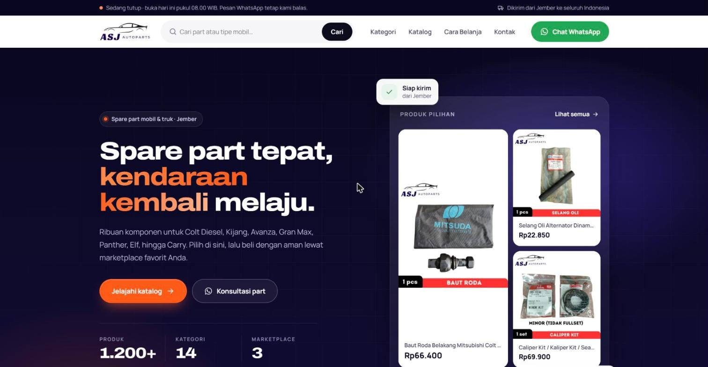

<div align="center">


### Spare part tepat, kendaraan kembali melaju.

Website katalog resmi **ASJ Autoparts**, toko spare part mobil & truk dengan 1.200+ produk.

[](https://nelsonrenalt.github.io/asj-autoparts/)
[](https://shopee.co.id/molycuteguy)
[](https://www.tokopedia.com/asj-autoparts)
[](https://vt.tiktok.com/ZSsh4mmS2/)
[](https://wa.me/6282302150788)

<br>



</div>

---

## ✨ Fitur

| | |
|---|---|
| 🔎 **Pencarian pintar** | Paham istilah bengkel, misalnya *laher = bearing*, *kampas = brake pad*, *fan belt = tali kipas* |
| 🗂️ **Filter lengkap** | Kategori, merk kendaraan (Mitsubishi, Toyota, Daihatsu, Isuzu, Suzuki, Hino), merk part, dan ketersediaan stok |
| 🛒 **Beli langsung** | Setiap produk terhubung ke Shopee, Tokopedia, dan TikTok Shop |
| 💬 **Tanya via WhatsApp** | Pesan otomatis berisi nama produk, varian, dan harga |
| 🟢 **Status toko real-time** | Menampilkan *buka / tutup* sesuai jam operasional (WIB) |
| 📱 **Mobile-first** | Nyaman dipakai di HP: tombol besar, filter geser, galeri bisa di-swipe |
| ♿ **Ramah pengguna (HCI)** | Navigasi keyboard, kontras warna jelas, tombol *Back* berfungsi, link produk bisa dibagikan |
| 🌐 **SEO Google** | 1.248 halaman produk + `sitemap.xml` + data terstruktur (Product schema) agar mudah ditemukan di Google |
| ⚡ **Ringan & gratis** | Website statis tanpa server, di-hosting gratis di GitHub Pages |

## 🧱 Teknologi

HTML · CSS · JavaScript (tanpa framework) · Python (pengolah data produk) · GitHub Pages

Tipografi: **Archivo** (judul) & **Manrope** (teks)

## 📁 Struktur

```
asj-autoparts/
├── index.html               Halaman utama
├── assets/
│   ├── css/style.css        Tampilan
│   ├── js/config.js         ⚙️ Pengaturan toko (WA, jam buka, link marketplace)
│   ├── js/app.js            Logika katalog
│   └── img/                 Logo & ikon
├── data/products.json       Data produk (otomatis dari export Shopee)
├── produk/                  Halaman per produk untuk Google (otomatis)
├── sitemap.xml              Daftar halaman untuk Google (otomatis)
└── tools/
    ├── build_products.py    Export Shopee → products.json
    └── build_pages.py       products.json → halaman produk + sitemap
```

## 🔄 Memperbarui produk

1. **Shopee Seller Centre → Produk Saya → Update Massal**, lalu download *Info Dasar*, *Info Penjualan*, dan *Info Media*.
2. Simpan semua file `.xlsx` dalam satu folder, lalu jalankan:
   ```bash
   pip install python-calamine
   python tools/build_products.py "C:\path\ke\folder\export"
   ```
3. Unggah perubahan:
   ```bash
   git add .
   git commit -m "Update produk"
   git push
   ```
   Website otomatis ter-update dalam 1–2 menit.

> Jika mengubah `style.css` atau `app.js`, naikkan juga angka `?v=` di `index.html` agar pengunjung langsung mendapat versi terbaru.

## ⚙️ Mengubah info toko

Edit `assets/js/config.js` untuk mengganti nomor WhatsApp, jam operasional, atau link marketplace.

## 💻 Menjalankan di komputer

```bash
python -m http.server 8000
```
Buka <http://localhost:8000>

---

<div align="center">

**ASJ Autoparts** · Jember, Jawa Timur · Senin – Sabtu, 08.00 – 17.00 WIB

</div>
